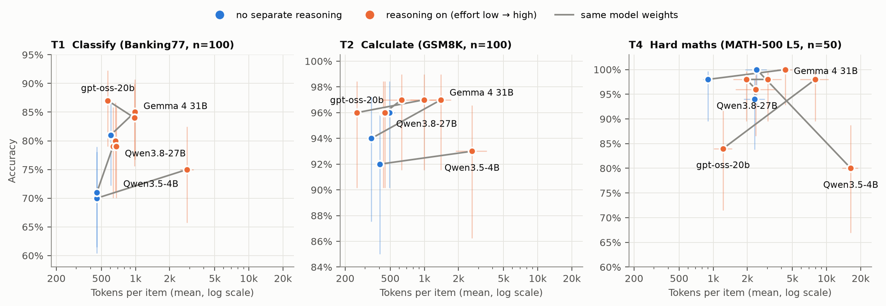
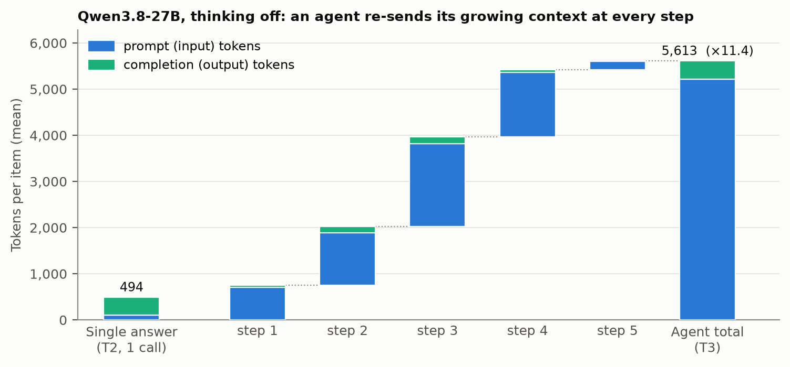

# Cheaper Tokens, Costlier Tasks

**Measuring tokens per task across reasoning settings, model size and agentic tool use**

Kalun Ho · November 2026 · [Technical report](paper/technical_report.md) · [Full results](results/RESULTS.md)

<!-- Video: add the YouTube link here -->

> AI tokens got ~280× cheaper in two years [Stanford AI Index 2025], so why do AI bills go up?
> A bill is *price per token × tokens per task × tasks*. This repository measures the middle term
> on matched tasks, changing one setting at a time, and releases every call that was made.



## Key findings

Four open-weight models (Qwen3.5-4B, Qwen3.8-27B, Gemma 4 31B, gpt-oss-20b), 12 conditions, 4 task families with exact answer keys, 2,540 scored items, one RTX 5090.

| | Finding | Number |
|---|---|---|
| 1 | **Reasoning multiplies tokens per item.** Same weights, same task, reasoning on vs off | up to **×6.8** |
| 2 | **…and on routine tasks buys little.** Accuracy gain on classification and arithmetic | ≤ **+9 pp**, often within noise |
| 3 | **A small model that reasons is not cheap.** Qwen3.5-4B thinking vs Qwen3.8-27B direct | **×5–×7** tokens; accuracy +4 / −3 / **−14 pp** (hard maths) (20% of replies hit the token limit) |
| 4 | **Agents multiply tokens by an order of magnitude.** Agent lookup vs single answer, same model | **×11.4** (95% CI 9.6–13.2); **93%** of it re-sent context |
| 5 | **Reasoning pays clearly only on hard problems.** gpt-oss-20b on MATH level 5, high vs low effort | **+14 pp** for ×6.5 tokens |

The metric to budget is **cost per successful task**: tokens per task drive it, and routing easy tasks to small models with reasoning off is the main lever.



## Repository

```
├── paper/technical_report.md      the write-up (method, results, limitations, references)
├── src/tokens_per_task/           the measurement harness (Python ≥ 3.11, standard library only)
│   ├── config.py                  models, conditions, request settings: what was measured
│   ├── prompts.py, datasets.py    tasks and the seeded item samples
│   ├── ledger.py                  T3 agent environment: synthetic ledger, questions, tools
│   ├── scoring.py                 exact-match scoring (no LLM judge)
│   ├── runner.py, client.py       calls, agent loop, token accounting
│   └── cli.py                     `python run.py <command>`
├── analysis/                      make_report.py (tables), make_figures.py, cost.py, stats.py
├── data/                          benchmark files used (with SHA-256) and the generated ledger
├── results/                       every call and item, summary, setup record, raw run logs
├── figures/                       PNG + PDF
├── docs/                          reproduce.md, preregistration.md (design written before the runs)
└── tests/                         unit, reproducibility and end-to-end tests (mock servers, no GPU)
```

## Quick start

No installation needed beyond Python 3.11+.

```bash
python run.py check                    # no GPU: data, all 20 agent answer keys, tools, request bodies
python -m pytest                       # 39 tests, incl. "published results recompute exactly"
python analysis/make_report.py         # regenerate results/RESULTS.md from the raw files
pip install matplotlib && python analysis/make_figures.py
```

**Price it yourself.** Apply any list prices (per 1M tokens) to the measured token counts:

```bash
python analysis/cost.py --input-price 0.20 --output-price 0.80 --currency EUR
```

**Re-run the measurement** on your own GPU against any OpenAI-compatible vLLM server:

```bash
vllm serve Qwen/Qwen3.5-4B --served-model-name qwen3.5-4b --max-model-len 32768 --reasoning-parser qwen3
python run.py run --config S,S-on --base-url http://localhost:8000/v1 --summarise
```

See [docs/reproduce.md](docs/reproduce.md) for every model, the smoke test and the full plan.

## Data and results

| File | Contents |
|---|---|
| [`results/items.csv`](results/items.csv) | one row per item: tokens (prompt, completion, reasoning), calls, tool calls, latency, correct, truncated, expected vs predicted |
| [`results/calls.csv`](results/calls.csv) | one row per model call (2,642) |
| [`results/summary.json`](results/summary.json) | aggregates per condition × task |
| [`results/RESULTS.md`](results/RESULTS.md) | all tables with 95% CIs and paired contrasts |
| [`results/setup.md`](results/setup.md) | served models, vLLM versions, GPU, request settings |
| [`results/logs/`](results/logs) | raw console logs of the smoke and full runs |

Schemas: [results/README.md](results/README.md). Data sources and licences: [data/README.md](data/README.md).

## Limitations

These are open models in quantised builds, so the **multipliers** transfer and the absolute counts do not. Benchmarks stand in for business tasks, the agent task is synthetic, and n is 20–100 per cell with one sample per item. GSM8K and MATH may be in the models' training data. See §6 of the [report](paper/technical_report.md#6-limitations).

## Citation

```bibtex
@techreport{ho2026tokenspertask,
  title       = {Cheaper Tokens, Costlier Tasks: Measuring Tokens per Task Across Reasoning
                 Settings, Model Size and Agentic Tool Use},
  author      = {Ho, Kalun},
  year        = {2026},
  month       = nov,
  type        = {Technical report},
  url         = {https://github.com/kalunho17/yt-experiment-001}
}
```

## Licence

Code: MIT ([LICENSE](LICENSE)). Results, figures and report: CC BY 4.0.

**Datasets.** This study uses [Banking77](https://github.com/PolyAI-LDN/task-specific-datasets) (Casanueva et al., 2020; CC BY 4.0), [GSM8K](https://github.com/openai/grade-school-math) (Cobbe et al., 2021; MIT) and [MATH-500](https://github.com/openai/prm800k) (Lightman et al., 2024, a subset of MATH by Hendrycks et al., 2021; MIT). Unmodified copies are redistributed in `data/raw/` under their original licences. See [THIRD_PARTY_NOTICES](data/raw/THIRD_PARTY_NOTICES.md) and [data/README.md](data/README.md) for full references.
