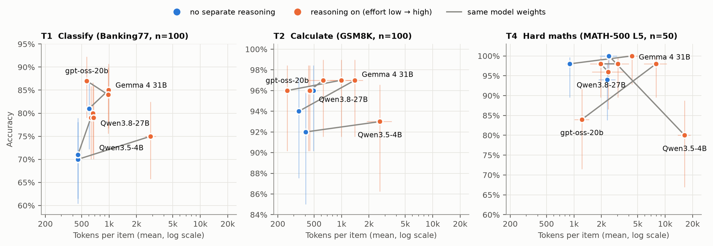
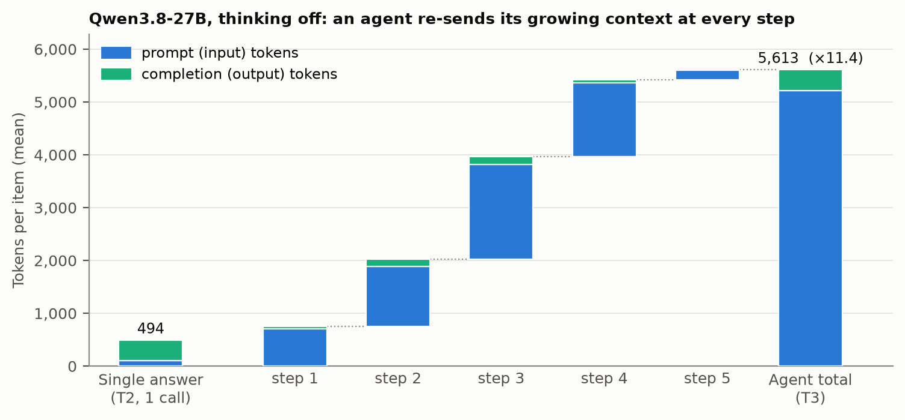

# Cheaper Tokens, Costlier Tasks: Measuring Tokens per Task Across Reasoning Settings, Model Size and Agentic Tool Use

**Kalun Ho**
Technical report · November 2026 · Code, data and raw logs: this repository

---

## Abstract

The price of a language-model token has fallen by orders of magnitude (the inference price for GPT-3.5-level performance fell about 280-fold between November 2022 and October 2024 [1]), yet organisations report rising AI bills. A bill is the product of *price per token*, *tokens per task* and *number of tasks*. We measure the middle factor directly. On a single consumer GPU (RTX 5090, vLLM) we run four open-weight models (Qwen3.5-4B, Qwen3.8-27B, Gemma 4 31B, gpt-oss-20b) in 12 conditions that differ only in reasoning setting, model size or agentic tool use. The tasks are four task families with exact answer keys: intent classification (Banking77), grade-school arithmetic (GSM8K), competition mathematics (MATH-500, level 5) and a tool-using analyst task on a synthetic invoice ledger. That gives 2,540 scored items and 2,642 model calls. Holding the model and task fixed, switching reasoning on multiplied tokens per item by up to ×6.8. On classification and arithmetic, the accuracy gain was at most +9 percentage points and was often within noise. Reasoning paid for itself clearly only on hard mathematics with gpt-oss-20b (+14 pp for ×6.5 tokens). A 4B model that reasons used ×5–×7 the tokens of a 27B model that answers directly, with no reliable accuracy gain (+4, −3, −14 pp). On hard maths it was 14 pp *less* accurate, because 20% of its replies ran into the 28k-token limit. The same 27B model solving a lookup task as an agent consumed **×11.4** (95% CI ×9.6–×13.2) the tokens of a single-answer task. 93% of those tokens were re-sent context. At the documented rate of price decline, each multiplier cancels roughly eight to ten months of falling prices. We release the harness, all per-call logs and analysis scripts, and propose *tokens (or cost) per successful task* as the quantity to budget and monitor.

---

## 1 Introduction

Discussions of AI cost usually quote price per token. For anyone paying the bill, the relevant quantity is

$$
\text{cost} \;=\; \underbrace{\text{price per token}}_{\text{falling}} \;\times\; \underbrace{\text{tokens per task}}_{\text{this report}} \;\times\; \underbrace{\text{tasks}}_{\text{growing}} .
$$

When the first factor falls, the other two can grow faster, a pattern first described for coal by Jevons [2]. Two recent developments increase tokens per task in particular. *Reasoning* models generate a hidden chain of thought before answering [3, 4]. *Agents* call tools in a loop and re-send their growing context at every step [5, 6]. Reasoning is increasingly on by default, and agent frameworks loop by design.

How large is the tokens-per-task factor, and what does it buy? Published figures exist for proprietary systems (e.g. multi-agent research systems reported to use about 15× the tokens of a chat interaction [7]). Controlled measurements on matched tasks, where only one setting changes, are rare. This report provides one:

1. **An open, dependency-free measurement harness.** It runs any OpenAI-compatible server, scores against answer keys (no LLM judge), records every call's prompt, completion and reasoning tokens, and is resumable and testable without a GPU.
2. **A controlled measurement.** It covers 12 conditions × 4 task families on four open-weight models from three vendors: reasoning off vs on, a four-step reasoning-effort dial on fixed weights, small vs mid-size models, and single answer vs agent.
3. **Three findings.**
   - Reasoning multiplies tokens per item by ×1.3–×6.8, with small accuracy gains on routine tasks.
   - A small model that reasons can cost more tokens than a larger model that does not, without being more accurate.
   - Agentic tool use multiplies tokens by an order of magnitude, dominated by re-sent context.

## 2 Related work

**Price trends.** The AI Index [1], drawing on Epoch AI data, documents a roughly 280× drop in the price of GPT-3.5-level inference from November 2022 to October 2024. Price per unit of capability is not cost per task, which is what we measure.

**Test-time compute.** Chain-of-thought prompting [3] and models trained to reason at length trade tokens for accuracy; Snell et al. [4] study when that trade is efficient. Work on *overthinking* [8] shows that reasoning models spend many tokens on easy problems. Our T1/T2 results are a deployment-level instance of this.

**Agents and cost-aware evaluation.** ReAct-style agents [5] interleave reasoning and tool calls. Kapoor et al. [6] argue that agent benchmarks must report cost alongside accuracy. We follow that advice and also isolate where the agent's tokens go.

**Routing.** FrugalGPT [9] and RouteLLM [10] send queries to cheaper models when possible. Our small-vs-large contrasts give per-task evidence for such routing rules, and a caveat: a small model is only cheap if its reasoning stays off.

## 3 Experimental setup

### 3.1 Tasks

All tasks have exact answer keys, so success is counted, not judged. Items are drawn once with `random.Random(42)`, and every condition sees the same items.

| Task | Source (licence) | n | Stands for | Scoring |
|---|---|--:|---|---|
| **T1 Classify** | Banking77 test split [11] (CC BY 4.0); prompt lists all 77 intents | 100 | routing a support ticket | normalised exact label |
| **T2 Calculate** | GSM8K test split [12] (MIT) | 100 | a multi-step business calculation | final number exact |
| **T4 Hard maths** | MATH-500 [13, 14] (MIT, via PRM800K), level 5 with integer answers (74 problems) | 50 | a hard analytical problem | final integer exact |
| **T3 Agent** | Synthetic ledger: 500 invoices, 12 suppliers, 2025; tools `list_suppliers`, `get_invoices(supplier, quarter)`, `calculator(expr)`; ≤ 15 steps | 20 | an analyst question answered by looking things up | within 1% / exact supplier name |

The T3 ledger and its 20 questions (8 question types: totals, differences, quarter-on-quarter change, highest/lowest of three, counts above a threshold, maxima, averages) are generated deterministically. Every answer key is recomputed independently from the tool outputs a model would see (`python run.py check`). The calculator is a whitelisted AST evaluator. Prompts are reproduced verbatim in Appendix A.

### 3.2 Models and conditions

| Condition | Model (served build) | Setting | Tasks |
|---|---|---|---|
| S / S-on | Qwen3.5-4B (BF16) [17] | thinking off / on | T1, T2, T4 |
| Q-off | Qwen3.8-27B (NVFP4) [17] | thinking off | T1, T2, T4 |
| Q-low / Q-med / Q-xhigh | Qwen3.8-27B (NVFP4) | reasoning effort low / medium / xhigh (xhigh is the default) | T1, T2, T4 |
| G-off / G-on | Gemma 4 31B-it (QAT W4A16) [18] | thinking off / on | T1, T2, T4 |
| O-low / O-high | gpt-oss-20b (MXFP4) [15] | reasoning effort low / high | T1, T2, T4 |
| Q-A / Q-A-low | Qwen3.8-27B (NVFP4) | agent with tools; thinking off / effort low | T3 |

Qwen3.8-27B is the main subject because one set of weights offers four reasoning settings. Gemma 4 and gpt-oss add two further vendors, so a result is not one model family's quirk. Sampling follows each model card (Appendix B). The request seed is 42 and `max_tokens` is 28,000 within a 32,768-token context. One sample per item.

### 3.3 Serving

All runs used one NVIDIA GeForce RTX 5090 (32 GB) and vLLM [16] (0.26.0; a development build for Qwen3.8-27B), one model at a time. Reasoning was returned in a separate channel by the server's reasoning parser. Tool calls used native function calling. Requests ran with concurrency 8 (4 for Gemma 4, whose KV cache held about 35k tokens). Before the full runs, a smoke stage of 5 items per condition checked automatically that:

- reasoning appears exactly when it should;
- reasoning never leaks into the answer text;
- tool calls are parsed.

All checks passed for all four models. Weights (Hugging Face repo @ revision): `unsloth/Qwen3.8-27B-NVFP4@7d6f8d4`, `Qwen/Qwen3.5-4B@851bf6e`, `google/gemma-4-31B-it-qat-w4a16-ct@52f3f65`, `openai/gpt-oss-20b@6cee5e8`. Full hashes, served ids, vLLM versions and request settings are in `results/setup.md`.

### 3.4 Metrics

For item $i$ with calls $j = 1,\dots,J_i$:

$$
\text{tokens}_i = \sum_{j=1}^{J_i} \big(\text{prompt}_{ij} + \text{completion}_{ij}\big),
\qquad
\text{tokens per correct item} = \frac{\sum_i \text{tokens}_i}{\#\text{correct}} .
$$

Reasoning tokens are part of completion tokens. They are counted with the served model's tokenizer when the server does not report them. Prompt tokens are summed over all calls because a stateless API bills the full context on every call. Replies that hit the token limit count as failures. *Tokens per correct item* is the price-independent cost of one successful task. With prices $p_\text{in}, p_\text{out}$ it becomes cost per successful task, $\sum_i(p_\text{in}\,\text{prompt}_i + p_\text{out}\,\text{completion}_i)/\#\text{correct}$ (`analysis/cost.py`).

### 3.5 Statistical analysis

Accuracy intervals are Wilson 95% intervals. Means use a percentile bootstrap over items (10,000 resamples). Because all conditions share the same items, contrasts between two conditions on the same task resample item ids jointly (paired bootstrap) for both Δ accuracy and the ratio of mean tokens. The agent-vs-single-answer ratio compares different items and uses an unpaired bootstrap. We report intervals, not significance stars. With n = 50–100, differences below about 5 pp are not resolvable.

## 4 Results

Full per-condition tables, all contrasts, failure annotations and throughput are in [`results/RESULTS.md`](../results/RESULTS.md). Figure 1 summarises the single-answer tasks.



**Figure 1.** Accuracy vs mean tokens per item (log scale) for the single-answer tasks. Blue: the model reasons only in its visible answer. Orange: a separate reasoning phase is on. Grey lines connect settings of the same weights (for Qwen3.8-27B: off → low → medium → xhigh). Thin bars: 95% intervals. Up is better, left is cheaper.

### 4.1 Reasoning multiplies tokens; on routine tasks it buys little

**Table 1.** Effect of the reasoning setting, A vs B on identical items (paired bootstrap 95% CI).

| Model: A vs B | Task | Δ accuracy (pp) | Token ratio |
|---|---|--:|--:|
| Qwen3.5-4B: on vs off | T1 | +5 [−2, +12] | ×6.27 [5.43, 7.11] |
| | T2 | +1 [−4, +6] | ×6.51 [4.88, 8.63] |
| | T4 | **−20** [−32, −10] | ×6.77 [5.77, 8.13] |
| Qwen3.8-27B: xhigh vs off | T1 | +8 [+2, +14] | ×1.48 [1.37, 1.62] |
| | T2 | +1 [0, +3] | ×1.27 [0.85, 1.94] |
| | T4 | +4 [−4, +12] | ×1.31 [1.04, 1.62] |
| Gemma 4 31B: on vs off | T1 | +4 [+1, +8] | ×1.64 [1.56, 1.72] |
| | T2 | +3 [0, +7] | ×4.11 [3.37, 4.91] |
| | T4 | +2 [0, +6] | ×4.81 [4.32, 5.32] |
| gpt-oss-20b: high vs low | T1 | −3 [−8, +2] | ×1.72 [1.57, 1.87] |
| | T2 | +1 [−3, +6] | ×3.92 [3.06, 4.87] |
| | T4 | **+14** [+6, +24] | ×6.50 [5.38, 7.61] |

**Arithmetic (T2)** is near ceiling for every condition (92–97%). Reasoning adds at most +3 pp but multiplies tokens by up to ×6.5. The cheapest correct answers came from gpt-oss-20b at low effort (96%, 254 tokens per item) and Gemma 4 without thinking (94%, 341).

**Classification (T1)** gains +4 to +9 pp from reasoning on three of four models at ×1.4–×6.3 tokens. For gpt-oss-20b, more effort made it slightly worse.

**Hard maths (T4)** is the only task where more reasoning clearly improved accuracy (gpt-oss-20b +14 pp). Even there, Gemma 4 *without* thinking reached 98% at 897 tokens per item, against 7,954 for gpt-oss at high effort with the same accuracy.

**The effort dial on fixed weights barely moves.** Qwen3.8-27B's low/medium/xhigh settings changed tokens per item by only ×0.85–×1.48 relative to thinking off. In this model's chat template, the effort level is an instruction rather than a token budget (and `medium` injects none). At low effort it even used *fewer* tokens than thinking off on T2 (×0.88), because its visible answer became shorter. Turning reasoning off does not remove reasoning: with thinking off, Qwen models wrote a mean of 2,168–2,272 completion tokens of visible working on T4.

### 4.2 A small model that reasons is not a cheap model

Comparing Qwen3.5-4B with thinking on to Qwen3.8-27B with thinking off (same vendor, same items), the small model used ×6.3 (T1), ×5.3 (T2) and ×7.1 (T4) the tokens. Its accuracy was +4 pp (n.s.), −3 pp and **−14 pp** respectively. On T4, 10 of 50 small-model replies hit the 28,000-token limit. All 40 that finished were correct, so the failures are runaway reasoning rather than wrong reasoning. The same small model *without* thinking solved all 50 T4 items at 2,422 tokens per item. A router that sends easy tasks to a small model saves money only if the small model's reasoning is off. Per-token price differences between a 4B and a 27B model would have to exceed these token ratios to compensate.

### 4.3 Agents multiply tokens by an order of magnitude



**Figure 2.** Contribution of each agent step to mean tokens per item (Qwen3.8-27B, thinking off, T3). Each bar starts where the previous one ended. The left bar is a single-answer task (T2) on the same weights and settings. Steps 4–5 are reached by fewer items, hence their smaller contribution to the per-item mean.

With identical weights and settings, the agentic lookup task used **5,613 tokens per item vs 494** for a single-answer calculation: ×11.4 (95% CI ×9.6–×13.2). Both agent conditions answered all 20 questions correctly. The agent made 3.8 calls and 4.3 tool calls per item. **93% of its tokens were prompt tokens.** The context grew from 712 tokens at the first call to about 2,000 by the third, because tool results (invoice lists) are appended and the whole conversation is re-sent at each step. Adding low-effort reasoning to the agent left the total unchanged (×0.98 [0.89, 1.05]): it took fewer steps (3.3) but generated more output. Agent cost is thus driven by context re-transmission, which input-token prices and prompt caching act on, more than by generation.

### 4.4 Throughput

Throughput depends on quantisation and serving flags more than on model size. Single-stream decode on the RTX 5090 reached 287 tok/s for gpt-oss-20b (MXFP4), 157 for Qwen3.5-4B (BF16), 71 for Gemma 4 31B (W4A16) and 20 for Qwen3.8-27B (NVFP4) (`results/RESULTS.md`). The token multipliers above therefore also translate into latency: at 20 tok/s on the 27B model, a few thousand reasoning tokens add minutes per item.

## 5 Discussion

**What to budget.** Price per token is the wrong unit for a budget. The quantities that moved in this study are tokens per task and success rate. We suggest tracking **cost per successful task** as the key metric, with *tokens per task* as its driver and the *share of tasks routed to small models without reasoning* as its main lever.

**A routing rule of thumb supported by these data:**

- Classification and routine arithmetic: smallest adequate model, reasoning **off**.
- Hard analytical problems: a model whose reasoning demonstrably helps on a sample of *your* tasks; cap the reasoning budget.
- Agents: shrink what is re-sent (compact tool outputs, summarise history, cache prompts) before shrinking the model.

**Defaults matter.** The most expensive settings in this study were the vendor defaults: xhigh effort for Qwen3.8-27B, and thinking on for the reasoning models. A team that never touches the setting pays the highest multiplier.

**The 280× in context.** Within this study's narrow scope, choices made at deployment time moved tokens per task by up to ×6.8 (reasoning) and ×11.4 (agent vs single answer) on fixed weights. They are made per task and can be reversed per task. At the rate documented by the AI Index (280× in 23 months), a ×6.8 multiplier offsets about eight months of price decline and ×11.4 about ten. A single deployment decision (switch on reasoning, or turn a prompt into an agent) can thus cancel most of a year of falling prices. Several such decisions together, plus growth in the number of tasks, can outrun the decline. Falling prices and rising bills are not a contradiction.

## 6 Limitations

- **Open models only.** Token counts are for these four open-weight models and their quantised builds. Proprietary models tokenise and reason differently. The *multipliers* are the transferable result, not absolute counts. Pricing these counts at a commercial model's list price is a projection.
- **Scope and sample size.** Three benchmark families and one synthetic agent task stand in for business workloads, with 100/100/50/20 items. One sample per item and one request seed, so sampling variance across seeds is not captured. Ceiling effects (T2, T3) limit what accuracy differences can show.
- **Contamination.** GSM8K and MATH have been public since 2021 and are likely in training data. This may inflate accuracy, and possibly reduce the tokens needed, for all conditions alike.
- **Serving specifics.** Results depend on chat templates, reasoning parsers, quantisation and vLLM version. The Qwen3.8 effort levels act as prompt instructions, not hard budgets. Model revisions come from the GPU host's model registry and were not re-hashed against the files on disk. The exact `vllm serve` flags and driver/CUDA versions were not recorded.
- **Agent design.** A single agent loop with native tool calls and compact JSON tool outputs. Multi-agent systems, longer horizons and larger tool outputs would raise the multiplier further. Tool errors and retries were rare here.
- **No energy figure.** GPU power draw was not available from the host's telemetry.

## 7 Reproducibility and compute

All code (Python ≥ 3.11, standard library only), the exact benchmark files used (with SHA-256 and licence notices, `data/raw/THIRD_PARTY_NOTICES.md`), the generated ledger, every per-call and per-item record, the raw run logs and the analysis scripts are in this repository. The full runs took 3.3 hours of wall-clock time on one RTX 5090 and processed 4.06M tokens (0.90M prompt, 3.16M completion) over 2,642 calls. A test suite checks four things: the published results contain exactly the seeded item samples, every item's totals equal the sum of its calls, `summary.json` recomputes exactly from `items.csv`, and the full pipeline runs end to end against mock servers. The original design, written before the runs, and its deviations are in `docs/preregistration.md`. See `docs/reproduce.md` for step-by-step instructions.

## References

[1] Stanford HAI. *Artificial Intelligence Index Report 2025.* Stanford University, 2025.
[2] W. S. Jevons. *The Coal Question.* Macmillan, 1865.
[3] J. Wei et al. Chain-of-thought prompting elicits reasoning in large language models. *NeurIPS*, 2022.
[4] C. Snell, J. Lee, K. Xu, A. Kumar. Scaling LLM test-time compute optimally can be more effective than scaling model parameters. arXiv:2408.03314, 2024.
[5] S. Yao et al. ReAct: Synergizing reasoning and acting in language models. *ICLR*, 2023.
[6] S. Kapoor, B. Stroebl, Z. S. Siegel, N. Nadgir, A. Narayanan. AI agents that matter. arXiv:2407.01502, 2024.
[7] Anthropic. How we built our multi-agent research system. Engineering blog, June 2025.
[8] X. Chen et al. Do NOT think that much for 2+3=? On the overthinking of o1-like LLMs. arXiv:2412.21187, 2024.
[9] L. Chen, M. Zaharia, J. Zou. FrugalGPT: How to use large language models while reducing cost and improving performance. arXiv:2305.05176, 2023.
[10] I. Ong et al. RouteLLM: Learning to route LLMs with preference data. arXiv:2406.18665, 2024.
[11] I. Casanueva, T. Temčinas, D. Gerz, M. Henderson, I. Vulić. Efficient intent detection with dual sentence encoders. *Proceedings of the 2nd Workshop on NLP for ConvAI, ACL*, 2020. arXiv:2003.04807. Data: github.com/PolyAI-LDN/task-specific-datasets (CC BY 4.0).
[12] K. Cobbe et al. Training verifiers to solve math word problems. arXiv:2110.14168, 2021. Data: github.com/openai/grade-school-math (MIT).
[13] D. Hendrycks et al. Measuring mathematical problem solving with the MATH dataset. *NeurIPS Datasets and Benchmarks*, 2021. arXiv:2103.03874. Data: github.com/hendrycks/math (MIT).
[14] H. Lightman et al. Let's verify step by step. *ICLR*, 2024. arXiv:2305.20050. MATH-500 split: github.com/openai/prm800k (MIT); copy used: huggingface.co/datasets/HuggingFaceH4/MATH-500.
[15] OpenAI. gpt-oss-120b & gpt-oss-20b model card. 2025.
[16] W. Kwon et al. Efficient memory management for large language model serving with PagedAttention. *SOSP*, 2023. (vLLM.)
[17] Qwen Team, Alibaba. Qwen3.5-4B and Qwen3.8-27B model cards. Hugging Face, 2026.
[18] Google DeepMind. Gemma 4 model card. 2026.

---

## Appendix A: Prompts (verbatim)

Single user turn, no system prompt. Source: `src/tokens_per_task/prompts.py`.

**T1**
```
Classify the customer message below into exactly one of these 77 intent labels:

<the 77 labels, one per line, sorted>

Customer message: "<text>"

Reply with the label only, exactly as written in the list, and nothing else.
```

**T2**
```
Solve the following problem. End your reply with a final line of the form 'Answer: <number>' (the number only, no units).

Problem: <question>
```

**T4**
```
Solve the following competition maths problem. The answer is an integer. End your reply with a final line of the form 'Answer: <integer>'.

Problem: <problem>
```

**T3** (tools: `list_suppliers`, `get_invoices`, `calculator`; `tool_choice: auto`)
```
You are a financial analyst with read access to a company's supplier invoice ledger for 2025 (amounts in EUR). Quarters: Q1 = Jan-Mar, Q2 = Apr-Jun, Q3 = Jul-Sep, Q4 = Oct-Dec 2025. Use the tools to look up the invoices and to do the arithmetic; do not guess numbers.

Question: <question>

When you have the result, end your reply with a final line of the form 'Answer: <value>', where <value> is a plain number without units or thousands separators, or a supplier name exactly as list_suppliers returns it.
```

## Appendix B: Request settings

All requests: `seed=42`, `max_tokens=28000`, `stream=false`.

| Condition | Sampling | Reasoning switch |
|---|---|---|
| S, Q-off, Q-A | T=0.7, top_p=0.8, top_k=20, presence_penalty=1.5 | `chat_template_kwargs.enable_thinking=false` |
| S-on | T=1.0, top_p=0.95, top_k=20 | `enable_thinking=true` |
| Q-low, Q-med, Q-xhigh, Q-A-low | T=1.0, top_p=0.95, top_k=20 | `chat_template_kwargs.reasoning_effort=low / medium / xhigh` |
| G-off, G-on | T=1.0, top_p=0.95, top_k=64 | `enable_thinking=false / true` |
| O-low, O-high | T=1.0, top_p=1.0 | `reasoning_effort=low / high` |
